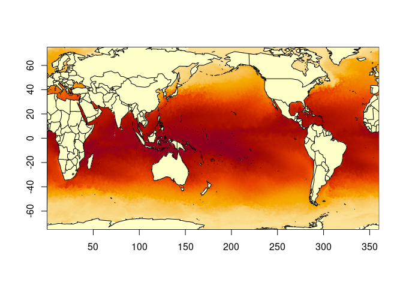
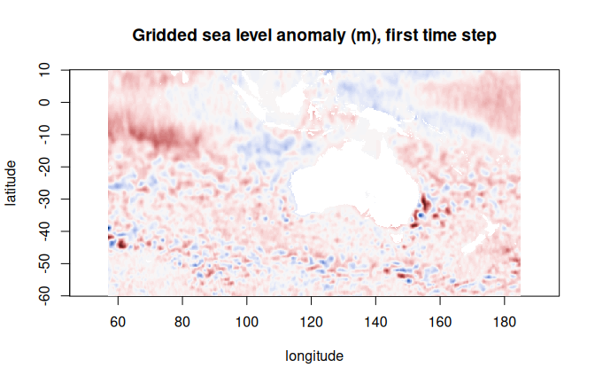
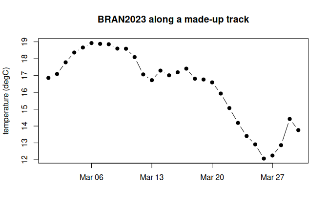
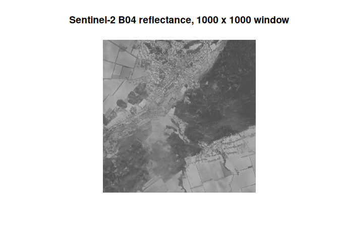

<!-- README.md is generated from README.Rmd. Please edit that file -->

<!-- The examples read live data (AODN on S3, BRAN2023 on NCI THREDDS, EOPF
on Copernicus S3), so they are shown, not run: outputs and figures come
from the precomputed articles in vignettes/articles. Keep README.md in step
by knitting this file (nothing is evaluated). -->

# zaro

<!-- badges: start -->
[](https://github.com/hypertidy/zaro/actions/workflows/R-CMD-check.yaml)
[](https://hypertidy.github.io/zaro/)
<!-- badges: end -->

zaro reads Zarr arrays into R: native Zarr V2 and V3 (sharded too), and
*virtual* Zarr, where the chunks are byte ranges inside NetCDF, HDF5 and
GeoTIFF files that stay where they are. Local disk, HTTP(S), S3 and GCS.

Every read is the same three steps, and you can run each one yourself:

    selection --zaro_plan()--> refs table --zaro_fetch()--> bytes --decode--> R array

The plan is a plain data frame with one row per chunk (path, offset, size),
in the shape of a [byterefs](https://github.com/byterefs/spec) view. The
fetch sends every row through one curl connection pool, merging touching
byte ranges. Decoding is R. arrow and GDAL are optional.



*One day of BRAN2023 surface temperature: 60 byte ranges in one NetCDF
file on NCI's THREDDS server, found by a VirtualiZarr reference store,
fetched in one merged request.*

## Install

```r
install.packages("zaro", repos = c("https://hypertidy.r-universe.dev",
                                    "https://cloud.r-project.org"))
```

Imports are light: curl, jsonlite, nanoparquet, S7 (and base R's methods
and utils). Optional: altarr (lazy arrays), arrow (S3 and GCS listing and
credentials, lz4/brotli/snappy codecs), gdalraster (GDAL `/vsi...` paths,
S3 and GCS without arrow), blosc, DBI and RSQLite (byterefs SQLite stores).

## A first look

```r
library(zaro)
options(zaro.verbose = FALSE)   # zaro explains what it does by default

ds <- zaro_dataset("s3://aodn-cloud-optimised/model_sea_level_anomaly_gridded_realtime.zarr",
                   anonymous = TRUE, region = "ap-southeast-2")
ds
#> <zaro_dataset> 8 array(s) [zaro::ArrowStore]
#>   GSL       float64  (LONGITUDE: 641, LATITUDE: 351, TIME: 2519)
#>   GSLA      float64  (LONGITUDE: 641, LATITUDE: 351, TIME: 2519)
#>   LATITUDE  float32  (LATITUDE: 351)
#>   LONGITUDE float32  (LONGITUDE: 641)
#>   TIME      float64  (TIME: 2519)
#>   UCUR      float64  (LONGITUDE: 641, LATITUDE: 351, TIME: 2519)
#>   VCUR      float64  (LONGITUDE: 641, LATITUDE: 351, TIME: 2519)
#>   filename  string   (TIME: 2519)
#>   attributes: 37
```

One request (the consolidated metadata), no array data. Then read a slice
(0-based `start`, `count` in Zarr order, `NA` for the rest of an axis):

```r
gsla <- zaro_read(ds, "GSLA", start = c(0, 0, 0), count = c(1, NA, NA))
dim(gsla)
#>      TIME  LATITUDE LONGITUDE
#>         1       351       641
```



Or open it as a lazy R array that reads only the chunks you index (an
[altarr](https://hypertidy.github.io/altarr/) ALTREP array, dimensions in
R order), with CF masking and unpacking:

```r
x <- zaro_array(ds, "GSLA", cf = TRUE)
dim(x)
#> [1]  641  351 2519

## both coordinates in one fetch, then a 200-day series at 155E, 35S
xy <- zaro_read_arrays(ds, c("LONGITUDE", "LATITUDE"))
i <- which.min(abs(xy$LONGITUDE - 155)); j <- which.min(abs(xy$LATITUDE + 35))
ts <- x[cbind(i, j, 1:200)]
summary(ts)
#>    Min. 1st Qu.  Median    Mean 3rd Qu.    Max.
#> -0.4010  0.1382  0.4242  0.3446  0.5358  0.8861
```

## Virtual stores: the bytes stay in place

A virtual store holds references, not data. Once open it behaves like any
other store.

| Source | Address |
|---|---|
| kerchunk JSON | `reference+json:///path/refs.json` |
| kerchunk Parquet | `reference+parquet:///path/refs.parquet` |
| VirtualiZarr Parquet manifests | `virtualizarr://https://.../dataset.parq` |
| byterefs SQLite table | `byterefs:///path/store.sqlite` |
| byterefs flat Parquet export | `flatrefs://https://.../store` |

byterefs stores apply their default path remap (`target`), so a table
scanned on a local mirror reads from the public copy. A flat refs store is
read by Parquet row group, only those whose statistics can hold the
selection: a one-day plan from BRAN2023's 37.5M-row `temp` table reads one
9 MB row group.

This made-up 30-day track off Tasmania reads one value per day from 30
NetCDF files, all fetched concurrently (the full code is in the
[virtual stores](https://hypertidy.github.io/zaro/articles/virtual-stores.html)
article):

```r
bran <- zaro_dataset("virtualizarr://https://raw.githubusercontent.com/mdsumner/virtualized/refs/heads/main/remote/ocean_temp_2023.parq")
temp <- zaro_array(bran, "temp", cf = TRUE)   # int16 unpacked to degrees C
dim(temp)
#> [1] 3600 1500   51 5479
system.time(track$temp <- temp[idx])          # idx: lon, lat, depth, day per row
#>    user  system elapsed
#>   0.539   0.128   1.024
```



## Plan, then fetch

```r
bran <- zaro("virtualizarr://https://raw.githubusercontent.com/mdsumner/virtualized/refs/heads/main/remote/ocean_temp_2023.parq")
p <- zaro_plan(bran, "temp", start = c(0, 0, 0, 0), count = c(1, 1, NA, NA))
p
#> <zaro_plan> 'temp': 60 chunk(s), 60 request(s)
#>   transport: http 60
#>   bytes:     3.6 MB
#>   hosts:     thredds.nci.org.au
#>           key transport  offset  size                                 path
#>  temp/0.0.0.0      http   46353 74186 ...N2023/daily/ocean_temp_2010_01.nc
#>  temp/0.0.1.0      http  941632 69286 ...N2023/daily/ocean_temp_2010_01.nc
#>   ... 58 more

raw <- zaro_fetch(bran, p)
attr(raw, "stats")$requests     # the 60 ranges touch, so they merge
#> [1] 1
```

## Sharded Zarr V3 and nested groups

A shard is planned as one more level of byte references: one small ranged
read for its index, then each inner chunk is a byte range of the shard.
This EOPF Sentinel-2 L2A product keeps its bands several groups down:

```r
eopf <- zaro("https://s3.explorer.eopf.copernicus.eu/esa-zarr-sentinel-explorer-fra/tests-output/sentinel-2-l2a/S2C_MSIL2A_20260120T084301_N0511_R064_T36UXA_20260120T122910.zarr")
zaro_groups(eopf)                                   # every group, arrays in each
r10m <- zaro_dataset(eopf, group = "measurements/reflectance/r10m")
v <- zaro_read(r10m, "b04", start = c(5000, 5000), count = c(1000, 1000))
```



Checked against zarr-python 3.2.1 and GDAL on this store, and against
GDAL's sharding test fixtures.

## What it covers

* **Zarr V2 and V3**: consolidated metadata (`.zmetadata`, consolidated
  `zarr.json`) including nested groups; `sharding_indexed` with its index at
  either end; numpy dtype strings, `_ARRAY_DIMENSIONS`, C and F order.
* **Types**: integers, floats (float16 too), bool, 64-bit integers as exact
  doubles; strings (`fixed_length_utf32`, `null_terminated_bytes`,
  `vlen-utf8`) as character.
* **Codecs**: zstd, gzip, zlib and bz2 in base R; blosc; lz4, brotli and
  snappy via arrow; shuffle, `imagecodecs_delta` (TIFF predictor 2);
  `crc32c` stripped. A codec zaro doesn't know is refused clearly.
* **Transport**: local files in base R; HTTP(S) with curl; S3 and GCS as
  HTTPS through the same pool when access is known (anonymous, or S3 keys
  in the environment), otherwise through arrow or GDAL; any GDAL `/vsi...`
  path through gdalraster.
* **Lazy arrays**: `zaro_array()` via altarr, with CF decoding.
* **ndr**: zaro is the Zarr engine for
  [ndr](https://hypertidy.github.io/ndr/)'s `open_dataset()` (labelled
  dimensions, selection by value, reductions).

## Functions

| | |
|---|---|
| `zaro()` | open a store (any of the sources above) |
| `zaro_dataset()`, `zaro_groups()` | every array of a group and its dimensions; the groups of a store |
| `zaro_list()`, `zaro_meta()` | list keys; read an array or group's metadata |
| `zaro_read()`, `zaro_read_arrays()` | a hyperslab as an R array; several whole arrays in one fetch |
| `zaro_array()` | a lazy R array, optionally CF-decoded |
| `zaro_plan()`, `zaro_fetch()` | the byte references a read needs; fetching them |
| `zaro_chunk()`, `zaro_chunks()`, `zaro_chunk_info()`, `zaro_chunk_apply()` | work chunk by chunk |

## Options

| Option | Default | |
|---|---|---|
| `zaro.verbose` | `TRUE` | diagnostic messages from every function |
| `zaro.max_con` | `8` | HTTP connections, per host and in total |
| `zaro.merge_gap` | `0` | merge byte ranges this close on the same file |
| `zaro.cloud_anonymous` | `FALSE` | treat S3/GCS as anonymous (curl pool) |
| `zaro.flat_cache_row_groups` | `4` | flat refs row groups kept in memory |

## Learn more

The articles walk through each piece with live data:
[getting started](https://hypertidy.github.io/zaro/articles/getting-started.html),
[connecting to stores](https://hypertidy.github.io/zaro/articles/connecting.html)
(HTTPS, S3, GCS, custom endpoints, credentials, translating Python's
`storage_options`),
[virtual stores](https://hypertidy.github.io/zaro/articles/virtual-stores.html),
[planning, fetching and sharding](https://hypertidy.github.io/zaro/articles/plan-fetch-shard.html),
and [zaro as an ndr engine](https://hypertidy.github.io/zaro/articles/zaro-and-ndr.html).

Design notes live in
[`inst/docs-design/`](https://github.com/hypertidy/zaro/tree/main/inst/docs-design):
origin, parallelization, Icechunk, ecosystem position, cloud connection
helpers, URI interpretation, the roadmap, and zaro's position on byterefs.

## Related packages

* [ndr](https://hypertidy.github.io/ndr/): xarray-like labelled arrays for
  R; uses zaro for Zarr and virtual Zarr, GDAL for the rest.
* [altarr](https://hypertidy.github.io/altarr/): lazy chunked arrays as
  plain R arrays; `zaro_array()` is built on it.
* [zarr](https://CRAN.R-project.org/package=zarr) (CRAN) and
  [pizzarr](https://github.com/zarr-developers/pizzarr): R Zarr
  implementations with their own store and codec models.
* [gdalraster](https://github.com/firelab/gdalraster): GDAL bindings,
  including the Zarr driver and the multidimensional API; zaro uses its VSI
  layer when asked.
* [raad.virtualize](https://github.com/mdsumner/raad.virtualize): produces
  byterefs stores that zaro reads.

zaro implements the Zarr specification directly rather than wrapping a Zarr
library, so a store written by xarray or zarr-python reads without
conversion, and the same references serve Python, GDAL and zaro.
