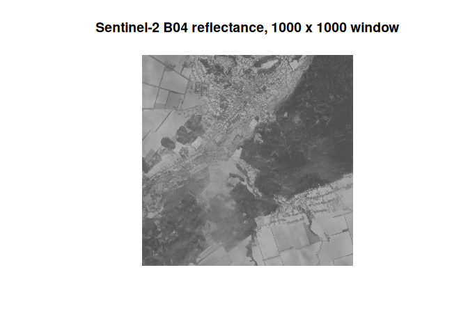

# Planning, fetching and sharding

Every zaro read goes through three steps you can also run yourself:

    selection --plan--> refs table --fetch--> raw bytes --decode--> array

[`zaro_plan()`](https://hypertidy.github.io/zaro/reference/zaro_plan.md)
says which bytes a read needs before anything is read;
[`zaro_fetch()`](https://hypertidy.github.io/zaro/reference/zaro_fetch.md)
gets them;
[`zaro_read()`](https://hypertidy.github.io/zaro/reference/zaro_read.md)
and
[`zaro_array()`](https://hypertidy.github.io/zaro/reference/zaro_array.md)
do both and decode. The plan is the same shape whatever the store: a
native Zarr chunk is a whole object, a virtual chunk is a byte range in
a NetCDF file, a sharded chunk is a byte range in a shard object.

## A plan

``` r
library(zaro)
options(zaro.verbose = FALSE)

bran <- zaro("virtualizarr://https://raw.githubusercontent.com/mdsumner/virtualized/refs/heads/main/remote/ocean_temp_2023.parq")

## the surface (st_ocean 0) on one day: 60 chunks of 300 x 300
p <- zaro_plan(bran, "temp", start = c(0, 0, 0, 0), count = c(1, 1, NA, NA))
p
#> <zaro_plan> 'temp': 60 chunk(s), 60 request(s)
#>   transport: http 60
#>   bytes:     3.6 MB
#>   hosts:     thredds.nci.org.au
#>           key transport  offset  size                                 path
#>  temp/0.0.0.0      http   46353 74186 ...N2023/daily/ocean_temp_2010_01.nc
#>  temp/0.0.1.0      http  941632 69286 ...N2023/daily/ocean_temp_2010_01.nc
#>  temp/0.0.2.0      http 1887166 26410 ...N2023/daily/ocean_temp_2010_01.nc
#>  temp/0.0.3.0      http 2663084 29798 ...N2023/daily/ocean_temp_2010_01.nc
#>  temp/0.0.4.0      http 3376949 45439 ...N2023/daily/ocean_temp_2010_01.nc
#>  temp/0.0.0.1      http  120539 66578 ...N2023/daily/ocean_temp_2010_01.nc
#>   ... 54 more
```

The columns follow the [byterefs](https://github.com/byterefs/spec)
view: `dim_0..dim_3` (the chunk’s grid index), `present`, `path`,
`offset`, `size` and `data` (inline bytes), then zaro’s `key` and
`transport`.

``` r
names(p)
#>  [1] "dim_0"     "dim_1"     "dim_2"     "dim_3"     "present"   "path"      "offset"   
#>  [8] "size"      "data"      "key"       "transport"
head(as.data.frame(p)[c("dim_2", "dim_3", "offset", "size", "transport")])
#>   dim_2 dim_3  offset  size transport
#> 1     0     0   46353 74186      http
#> 2     1     0  941632 69286      http
#> 3     2     0 1887166 26410      http
#> 4     3     0 2663084 29798      http
#> 5     4     0 3376949 45439      http
#> 6     0     1  120539 66578      http
```

It is a plain data frame: filter it, save it, or hand it to another
tool.

## Fetching

[`zaro_fetch()`](https://hypertidy.github.io/zaro/reference/zaro_fetch.md)
sends every HTTP row through one curl connection pool, at most `max_con`
connections per host. Byte ranges that touch in the same file are merged
into one request. This slice’s 60 chunks sit back to back in the NetCDF
file:

``` r
raw <- zaro_fetch(bran, p)
attr(raw, "stats")
#> $requests
#> [1] 1
#> 
#> $bytes
#> [1] 3754064
#> 
#> $seconds
#> [1] 1.390692
```

Merging cuts requests, at the cost of parallelism;
`options(zaro.merge_gap)` widens what counts as touching, and
`options(zaro.max_con)` sets the pool size.

## Sharded Zarr V3

In a sharded array, each stored object (a shard) packs many inner
chunks, with an index of where each one is. zaro plans a shard as one
more level of byte references: it reads the shard’s index with one small
ranged request, then each inner chunk is a byte range of the shard.

This is a Copernicus EOPF Sentinel-2 L2A product published as sharded
GeoZarr: each 10 m band is one 10980 x 10980 shard of 45 x 45 inner
chunks.

``` r
eopf <- zaro("https://s3.explorer.eopf.copernicus.eu/esa-zarr-sentinel-explorer-fra/tests-output/sentinel-2-l2a/S2C_MSIL2A_20260120T084301_N0511_R064_T36UXA_20260120T122910.zarr")
b04 <- zaro_meta(eopf, "measurements/reflectance/r10m/b04")
b04
#> <ZaroMeta> [array]
#>   dtype:  float32
#>   shape:  [10980 x 10980]
#>   chunks: [244 x 244]
#>   shards: [10980 x 10980] (index at end)
#>   dims:   y, x
#>   codecs: bytes -> blosc
#>   fill:   NaN
#>   size:   459.9 MB
#>   attrs:  6

## a 1000 x 1000 window: 25 inner chunks
pw <- zaro_plan(eopf, "measurements/reflectance/r10m/b04",
                start = c(5000, 5000), count = c(1000, 1000), meta = b04)
pw
#> <zaro_plan> 'measurements/reflectance/r10m/b04': 25 chunk(s), 25 request(s)
#>   transport: http 25
#>   bytes:     4.3 MB
#>   hosts:     s3.explorer.eopf.copernicus.eu
#>                                      key transport    offset   size
#>  measurements/reflectance/r10m/b04/c/0/0      http 146443989 180562
#>  measurements/reflectance/r10m/b04/c/0/0      http 146624551 171170
#>  measurements/reflectance/r10m/b04/c/0/0      http 147163191 182402
#>  measurements/reflectance/r10m/b04/c/0/0      http 147345593 183368
#>  measurements/reflectance/r10m/b04/c/0/0      http 155082390 182607
#>  measurements/reflectance/r10m/b04/c/0/0      http 146795721 183637
#>                                  path
#>  ...ements/reflectance/r10m/b04/c/0/0
#>  ...ements/reflectance/r10m/b04/c/0/0
#>  ...ements/reflectance/r10m/b04/c/0/0
#>  ...ements/reflectance/r10m/b04/c/0/0
#>  ...ements/reflectance/r10m/b04/c/0/0
#>  ...ements/reflectance/r10m/b04/c/0/0
#>   ... 19 more
```

``` r
v <- zaro_read(eopf, "measurements/reflectance/r10m/b04",
               start = c(5000, 5000), count = c(1000, 1000), meta = b04)
image(t(v[nrow(v):1, ]), col = grey.colors(64), asp = 1, axes = FALSE,
      main = "Sentinel-2 B04 reflectance, 1000 x 1000 window")
```



plot of chunk eopf-read

zaro’s sharded reads are checked against zarr-python and GDAL on this
store, against GDAL’s sharding test fixtures, and against arrays written
by zarr-python.
