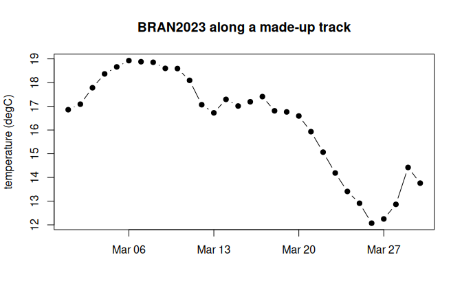

# Virtual stores

A virtual Zarr store holds no array data. It holds references: for each
chunk, which file holds its bytes and at what offset. The files are the
original NetCDF, HDF5 or GeoTIFF archives, served as they are. zaro
reads these reference stores directly:

| Source                         | Address                                   |
|--------------------------------|-------------------------------------------|
| kerchunk JSON                  | `reference+json:///path/refs.json`        |
| kerchunk Parquet               | `reference+parquet:///path/refs.parquet`  |
| VirtualiZarr Parquet manifests | `virtualizarr://https://.../dataset.parq` |
| byterefs SQLite tables         | `byterefs:///path/store.sqlite`           |
| byterefs flat Parquet export   | `flatrefs://https://.../store`            |

Once opened, a virtual store behaves like any other:
[`zaro_dataset()`](https://hypertidy.github.io/zaro/reference/zaro_dataset.md),
[`zaro_read()`](https://hypertidy.github.io/zaro/reference/zaro_read.md)
and
[`zaro_array()`](https://hypertidy.github.io/zaro/reference/zaro_array.md)
work the same.

## BRAN2023 ocean temperature

BRAN2023 is CSIRO’s ocean reanalysis: daily temperature at 51 depths on
a 0.1 degree grid, 2010 to 2024, about 11 TB as NetCDF on NCI’s THREDDS
server. This VirtualiZarr reference store, kept on GitHub, points into
those NetCDF files.

``` r
library(zaro)
options(zaro.verbose = FALSE)

bran <- zaro("virtualizarr://https://raw.githubusercontent.com/mdsumner/virtualized/refs/heads/main/remote/ocean_temp_2023.parq")
ds <- zaro_dataset(bran)
ds
#> <zaro_dataset> 11 array(s) [zaro::VirtualiZarrStore]
#>   Time           float64  (Time: 5479)
#>   Time_bnds      float64  (nv: 2, Time: 5479)
#>   average_DT     float64  (Time: 5479)
#>   average_T1     float64  (Time: 5479)
#>   average_T2     float64  (Time: 5479)
#>   nv             float64  (nv: 2)
#>   st_edges_ocean float64  (st_edges_ocean: 52)
#>   st_ocean       float64  (st_ocean: 51)
#>   temp           int16    (xt_ocean: 3600, yt_ocean: 1500, st_ocean: 51, Time: 5479)
#>   xt_ocean       float64  (xt_ocean: 3600)
#>   yt_ocean       float64  (yt_ocean: 1500)
#>   attributes: 9
```

`temp` is packed as 16-bit integers; its attributes say how to unpack
it:

``` r
ds$arrays$temp@attributes[c("scale_factor", "add_offset", "_FillValue", "units")]
#> $scale_factor
#> [1] 0.00778222
#> 
#> $add_offset
#> [1] 245
#> 
#> $`_FillValue`
#> [1] -32768
#> 
#> $units
#> [1] "degrees C"
```

## Extract a track

A lazy array with `cf = TRUE` unpacks values and masks the fill. Here is
a made-up 30-day track off eastern Tasmania, diving from 5 to 200 m: one
value per day, from 30 different chunks in 30 different NetCDF files.

``` r
temp <- zaro_array(ds, "temp", cf = TRUE)     # xt_ocean, yt_ocean, st_ocean, Time
dim(temp)
#> [1] 3600 1500   51 5479

coord <- function(nm) as.vector(zaro_read(bran, nm, meta = ds$arrays[[nm]]))
xt <- coord("xt_ocean"); yt <- coord("yt_ocean"); st <- coord("st_ocean")
units <- ds$arrays$Time@attributes$units; units
#> [1] "days since 1979-01-01"
## time steps are at midday (x.5 days): floor them to their calendar day
time <- as.Date(sub("^days since ", "", units)) + floor(coord("Time"))

track <- data.frame(date = as.Date("2023-03-01") + 0:29,
                    lon = seq(147.8, 152.5, length.out = 30),
                    lat = seq(-43.5, -39.0, length.out = 30),
                    depth = round(5 + 195 * (1 - cos(seq(0, pi, length.out = 30))) / 2))
near <- function(coord, v) vapply(v, function(z) which.min(abs(coord - z)), 1L)
idx <- cbind(near(xt, track$lon), near(yt, track$lat), near(st, track$depth),
             near(as.numeric(time), as.numeric(track$date)))

system.time(track$temp <- temp[idx])
#>    user  system elapsed 
#>   0.539   0.128   1.024
head(track)
#>         date      lon       lat depth     temp
#> 1 2023-03-01 147.8000 -43.50000     5 16.85644
#> 2 2023-03-02 147.9621 -43.34483     6 17.08991
#> 3 2023-03-03 148.1241 -43.18966     7 17.78253
#> 4 2023-03-04 148.2862 -43.03448    10 18.36619
#> 5 2023-03-05 148.4483 -42.87931    14 18.66192
#> 6 2023-03-06 148.6103 -42.72414    19 18.92651
```

``` r
plot(track$date, track$temp, type = "b", pch = 19, xlab = "", ylab = "temperature (degC)",
     main = "BRAN2023 along a made-up track")
```



plot of chunk plot-track

All 30 byte ranges are fetched concurrently through one connection pool.
That’s the default, up to 8 connections per host
(`options(zaro.max_con)`).

## byterefs tables

[byterefs](https://github.com/byterefs/spec) is a specification for
exactly this kind of table: one row per chunk with its file, offset and
size, plus what a reader needs to decode it.
[raad.virtualize](https://github.com/mdsumner/raad.virtualize) produces
byterefs stores as SQLite files, and publishes them as a flat Parquet
export (a directory with `arrays.json` and one `refs_<array>.parquet`
per array). zaro reads the first with `byterefs://` and the second with
`flatrefs://`, and applies the store’s default path remapping
(`meta.default_target`), so a table scanned on a local mirror reads from
its public copy:

``` r
store <- zaro("byterefs:///path/to/store.sqlite")                  # default target
store <- zaro("byterefs:///path/to/store.sqlite", target = "public") # another target
store <- zaro("flatrefs://https://host/path/to/store")              # flat Parquet export
```

A flat refs table can be large (BRAN2023’s `temp` is 37.5M rows, 324
MB), so zaro never reads it whole for a selection. It reads the Parquet
footer with one range request, then only the row groups whose `dim_k`
statistics can hold the chunks a plan needs: a one-day surface plan
reads one 9 MB row group. A point series over every day reads the table
one row group at a time.

The specification is still moving, so this part of zaro will follow it.
