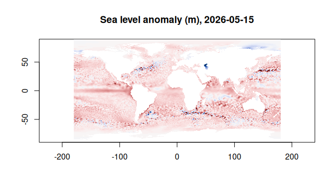
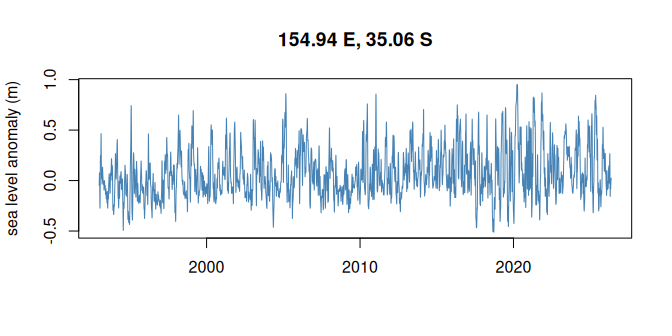
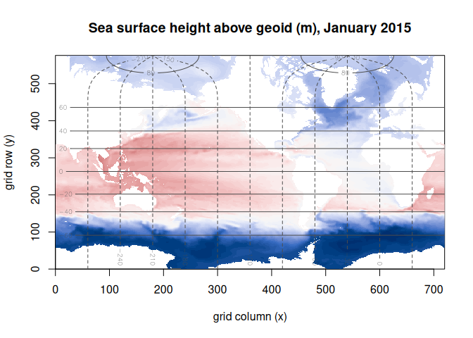
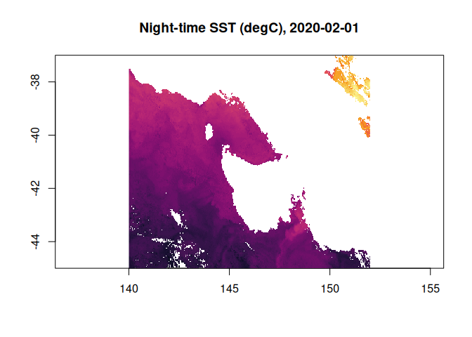
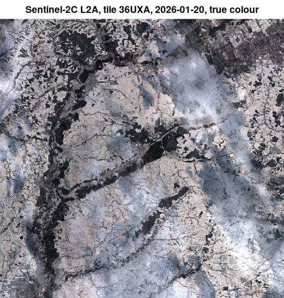
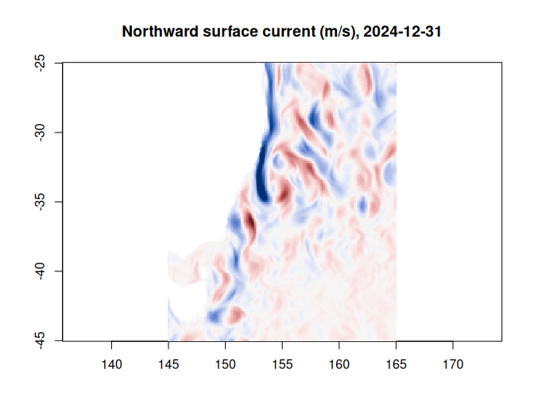

Public stores that zaro reads, across data providers, transports (HTTPS,
S3, GCS) and formats (Zarr V2 and V3, sharding, NetCDF through references).
Each section opens the store, shows a little of what is in it, and reads
one picture's worth of data.

| Store | From | Format | Transport | Shows |
|---|---|---|---|---|
| [Sea level, time-chunked](#sea-level-time-chunked) | Copernicus Marine | Zarr V2 | HTTPS | a global map from a lazy array, CF unpacking |
| [Sea level, geo-chunked](#sea-level-geo-chunked) | Copernicus Marine | Zarr V2 | HTTPS | 33 years at one point in a few requests |
| [CMIP6 sea surface height](#cmip6-sea-surface-height) | Pangeo CMIP6 | Zarr V2 | `gs://` | a model's curvilinear grid |
| [Himawari-8 SST](#himawari-8-sea-surface-temperature) | AODN | Zarr V2, blosc | `s3://` | a window of a 4500 x 6000 grid |
| [Sentinel-2 L2A](#sentinel-2-l2a) | ESA EOPF | Zarr V3, sharded | HTTPS | true colour from bands in a nested group |
| [BRAN2023 currents](#bran2023-currents) | CSIRO Bluelink at NCI | NetCDF, via VirtualiZarr | HTTPS (THREDDS) | byte ranges in NetCDF files read in place |

This article reads live data, so it is knitted ahead of time rather than
when the site is built (last on 2026-11-18). The same stores are
checked every week by the store gallery in the repository
([`gallery/`](https://github.com/hypertidy/zaro/tree/main/gallery)), which
reads a small selection from each and reports any that stop working. Other
kinds of store, such as Kerchunk references, byterefs tables and local
files, are in [virtual stores](virtual-stores.html) and
[getting started](getting-started.html).

The maps use base R's `image()` and
[ximage](https://hypertidy.github.io/ximage/). They want different orders,
and zaro gives both: a lazy array from `zaro_array()` is in R order
(`longitude, latitude`), which is what `image()` takes, while `zaro_read()`
gives Zarr order (`latitude, longitude`), which for a north-up grid is the
raster order `ximage()` takes.


``` r
library(zaro)
library(ximage)
options(zaro.verbose = FALSE)   # zaro explains what it does by default

## values beyond the colour range drawn at its ends, not left blank
clamp <- function(z, lim) pmin(pmax(z, -lim), lim)
## raster order for a grid stored south to north: first row at the top
north_up <- function(m) m[nrow(m):1, , drop = FALSE]
```

## Sea level, time-chunked

Copernicus Marine's global daily sea level, 1993 to the present at 1/8
degree, is published as two Zarr V2 copies of the same data. This one is
chunked for maps: one day, 512 x 1024 pixels per chunk.


``` r
cmems_time <- zaro(paste0("https://s3.waw3-1.cloudferro.com/mdl-arco-time-045/arco/",
                          "SEALEVEL_GLO_PHY_L4_MY_008_047/",
                          "cmems_obs-sl_glo_phy-ssh_my_allsat-l4-duacs-0.125deg_P1D_202411/",
                          "timeChunked.zarr"))
ds <- zaro_dataset(cmems_time)
ds
#> <zaro_dataset> 17 array(s) [zaro::HttpStore]
#>   adt            int32    (longitude: 2880, latitude: 1440, time: 12188)
#>   err_sla        int32    (longitude: 2880, latitude: 1440, time: 12188)
#>   err_ugosa      int32    (longitude: 2880, latitude: 1440, time: 12188)
#>   err_vgosa      int32    (longitude: 2880, latitude: 1440, time: 12188)
#>   flag_ice       int32    (longitude: 2880, latitude: 1440, time: 12188)
#>   lat_bnds       float32  (nv: 2, latitude: 1440)
#>   latitude       float32  (latitude: 1440)
#>   lon_bnds       float32  (nv: 2, longitude: 2880)
#>   longitude      float32  (longitude: 2880)
#>   nv             int32    (nv: 2)
#>   sla            int32    (longitude: 2880, latitude: 1440, time: 12188)
#>   time           float32  (time: 12188)
#>   tpa_correction int32    (time: 12188)
#>   ugos           int32    (longitude: 2880, latitude: 1440, time: 12188)
#>   ugosa          int32    (longitude: 2880, latitude: 1440, time: 12188)
#>   vgos           int32    (longitude: 2880, latitude: 1440, time: 12188)
#>   vgosa          int32    (longitude: 2880, latitude: 1440, time: 12188)
#>   attributes: 43
```

The arrays are int32, packed with a `scale_factor`. As a lazy array with
`cf = TRUE` they read as metres, with fill values as `NA`, in R's dimension
order (`longitude, latitude, time`). Indexing one day reads its nine chunks.


``` r
sla <- zaro_array(ds, "sla", cf = TRUE)
dim(sla)
#> [1]  2880  1440 12188
day <- dim(sla)[3]
z <- sla[, , day]
lon <- as.vector(zaro_read(ds, "longitude"))
lat <- as.vector(zaro_read(ds, "latitude"))
date <- as.Date("1950-01-01") + as.vector(zaro_read(ds, "time"))[day]
```


``` r
image(lon, lat, clamp(z, 0.6), asp = 1, zlim = c(-1, 1) * 0.6, col = hcl.colors(64, "Blue-Red 3"),
      xlab = "", ylab = "", main = sprintf("Sea level anomaly (m), %s", date))
```



## Sea level, geo-chunked

The other copy has the same arrays chunked for time series: 2264 days of
16 x 8 pixels per chunk. 33 years at one point in the Tasman Sea is six
chunks here; the time-chunked copy would need one per day.


``` r
cmems_geo <- zaro(paste0("https://s3.waw3-1.cloudferro.com/mdl-arco-geo-045/arco/",
                         "SEALEVEL_GLO_PHY_L4_MY_008_047/",
                         "cmems_obs-sl_glo_phy-ssh_my_allsat-l4-duacs-0.125deg_P1D_202411/",
                         "geoChunked.zarr"))
ilon <- which.min(abs(lon - 155))
ilat <- which.min(abs(lat - -35))
start <- c(0, ilat - 1, ilon - 1)   # 0-based, Zarr order: time, latitude, longitude
count <- c(NA, 1, 1)
nrow(zaro_plan(cmems_geo, "sla", start = start, count = count))
#> [1] 6
nrow(zaro_plan(cmems_time, "sla", start = start, count = count))
#> [1] 12188

series <- zaro_array(cmems_geo, "sla", cf = TRUE)[ilon, ilat, ]
dates <- as.Date("1950-01-01") + as.vector(zaro_read(cmems_geo, "time"))
```


``` r
plot(dates, series, type = "l", col = "steelblue", xlab = "", ylab = "sea level anomaly (m)",
     main = sprintf("%.2f E, %.2f S", lon[ilon], -lat[ilat]))
```



## CMIP6 sea surface height

Pangeo's CMIP6 archive on Google Cloud Storage: here GFDL-ESM4 monthly sea
surface height under SSP5-8.5. `cmip6` is a known public bucket, so zaro
reads it anonymously with no arguments. The ocean grid is curvilinear
(tripolar): `x` and `y` are nominal, and `lon` and `lat` are 2D arrays.
So the map is drawn on the grid itself, in columns and rows, with contours
of `lon` (dashed, every 30 degrees) and `lat` (solid, every 20) to show
where it is: north of about 65 N the grid bends to two poles, over Canada
and Siberia. Land is the array's fill value (1e20), which `cf = TRUE` reads
as `NA`.


``` r
cmip6 <- zaro(paste0("gs://cmip6/CMIP6/ScenarioMIP/NOAA-GFDL/GFDL-ESM4/",
                     "ssp585/r1i1p1f1/Omon/zos/gn/v20180701/"))
zaro_meta(cmip6, "zos")
#> <ZaroMeta> [array]
#>   dtype:  float32
#>   shape:  [1032 x 576 x 720]
#>   chunks: [61 x 576 x 720]
#>   dims:   time, y, x
#>   codecs: bytes -> blosc
#>   fill:   1.00000002004088e+20
#>   size:   1.6 GB
#>   attrs:  8
zos <- zaro_array(cmip6, "zos", cf = TRUE)[, , 1]   # x, y; the first month
dim(zos)
#> [1] 720 576
lon <- zaro_read(cmip6, "lon")                      # y, x
lat <- zaro_read(cmip6, "lat")
```


``` r
ximage(north_up(t(zos)), zlim = c(-1, 1) * max(abs(zos), na.rm = TRUE),
       col = hcl.colors(64, "Blue-Red 3"), xlab = "grid column (x)", ylab = "grid row (y)",
       main = "Sea surface height above geoid (m), January 2015")
xcontour(north_up(lat), add = TRUE, levels = seq(-60, 80, by = 20), col = "grey30", labcex = 0.6)
xcontour(north_up(lon), add = TRUE, levels = seq(-270, 30, by = 30), col = "grey30", lty = 2,
         labcex = 0.6)
```



## Himawari-8 sea surface temperature

AODN's cloud-optimised GHRSST L3C night-time SST from Himawari-8 on S3,
2015 to 2022: a 4500 x 6000 grid at 0.02 degrees, float64 compressed with
blosc. The window around Tasmania is four chunks. Gaps are cloud.


``` r
him <- zaro("s3://aodn-cloud-optimised/satellite_ghrsst_l3c_1day_nighttime_himawari8.zarr",
            region = "ap-southeast-2", anonymous = TRUE)
lon <- as.vector(zaro_read(him, "lon"))
lat <- as.vector(zaro_read(him, "lat"))   # north to south
time <- as.POSIXct(as.vector(zaro_read(him, "time")), origin = "1981-01-01", tz = "UTC")
ix <- which(lon >= 140 & lon <= 152)
iy <- which(lat >= -45 & lat <= -37)
it <- which(format(time, "%Y-%m-%d") == "2020-02-01")
sst <- zaro_read(him, "sea_surface_temperature", start = c(it, min(iy), min(ix)) - 1,
                 count = c(1, length(iy), length(ix)))
dim(sst)
#> time  lat  lon 
#>    1  400  600
```

The rows already run north to south, so the slice is in raster order as
read; the extent is the outer edges of the 0.02 degree cells.


``` r
ext <- c(range(lon[ix]), range(lat[iy])) + c(-1, 1, -1, 1) * 0.01
ximage(sst[1, , ] - 273.15, extent = ext, asp = 1 / cos(41 * pi / 180),   # kelvin to degC
       col = hcl.colors(64, "Inferno"),
       main = sprintf("Night-time SST (degC), %s", format(time[it], "%Y-%m-%d")))
```



## Sentinel-2 L2A

ESA's EOPF Sentinel-2 products are Zarr V3: nested groups, each band one
shard of 183 x 183 chunks, compressed with blosc. `zaro_groups()` lists the
groups; a dataset opens one of them.


``` r
eopf <- zaro(paste0("https://s3.explorer.eopf.copernicus.eu/esa-zarr-sentinel-explorer-fra/",
                    "tests-output/sentinel-2-l2a/",
                    "S2C_MSIL2A_20260120T084301_N0511_R064_T36UXA_20260120T122910.zarr"))
grp <- zaro_groups(eopf)
grp[grepl("^measurements", grp$group), ]
#>                             group arrays
#> 17                   measurements      0
#> 18       measurements/reflectance      0
#> 19  measurements/reflectance/r10m      7
#> 20 measurements/reflectance/r120m     14
#> 21  measurements/reflectance/r20m     13
#> 22 measurements/reflectance/r360m     14
#> 23  measurements/reflectance/r60m     14
#> 24 measurements/reflectance/r720m     14
r120 <- zaro_dataset(eopf, group = "measurements/reflectance/r120m")
zaro_meta(r120$store, "measurements/reflectance/r120m/b04")
#> <ZaroMeta> [array]
#>   dtype:  float32
#>   shape:  [915 x 915]
#>   chunks: [183 x 183]
#>   shards: [915 x 915] (index at end)
#>   dims:   y, x
#>   codecs: bytes -> blosc
#>   fill:   NaN
#>   size:   3.2 MB
#>   attrs:  6
```

Red, green and blue reflectance at 120 m, three shards. It is January
and the ground is snow-covered, so the reflectance needs no brightening.


``` r
bands <- lapply(c(red = "b04", green = "b03", blue = "b02"), function(b) zaro_read(r120, b))
dim(bands$red)
#>   y   x 
#> 915 915
unit <- function(v) {
  v <- pmin(pmax(v, 0), 1)
  v[is.na(v)] <- 0
  v
}
img <- array(unlist(lapply(bands, unit)), c(dim(bands$red), 3))   # y, x, band
```

The bands are `y, x` from north to south, raster order, so the RGB array
goes straight to `ximage()`.


``` r
par(mar = c(0, 0, 2, 0))
ximage(img, axes = FALSE, main = "Sentinel-2C L2A, tile 36UXA, 2026-01-20, true colour")
```



## BRAN2023 currents

CSIRO's Bluelink reanalysis (BRAN2023) is daily NetCDF files on NCI's
THREDDS server. A VirtualiZarr reference store (a Parquet file on GitHub)
says where each chunk is in those files, and zaro reads the byte ranges in
place: no copy of the data, no NetCDF library.


``` r
bran <- zaro(paste0("virtualizarr://https://raw.githubusercontent.com/mdsumner/",
                    "virtualized/refs/heads/main/remote/ocean_v_2023.parq"))
v <- zaro_array(bran, "v", cf = TRUE)
dim(v)                                 # xu_ocean, yu_ocean, st_ocean, Time
#> [1] 3600 1500   51 5479
xu <- as.vector(zaro_read(bran, "xu_ocean"))
yu <- as.vector(zaro_read(bran, "yu_ocean"))
days <- as.Date("1979-01-01") + as.vector(zaro_read(bran, "Time"))
ix <- which(xu >= 145 & xu <= 165)
iy <- which(yu >= -45 & yu <= -25)
nt <- length(days)
z <- v[ix, iy, 1, nt]
```

The plan for that read: byte ranges of one NetCDF file.


``` r
p <- zaro_plan(bran, "v", start = c(nt, 1, min(iy), min(ix)) - 1,
               count = c(1, 1, length(iy), length(ix)))
p
#> <zaro_plan> 'v': 4 chunk(s), 4 request(s)
#>   transport: http 4
#>   bytes:     336.1 KB
#>   hosts:     thredds.nci.org.au
#>           key transport     offset   size                                 path
#>  v/5478.0.0.4      http 6541854897  83553 ...BRAN2023/daily/ocean_v_2024_12.nc
#>  v/5478.0.1.4      http 6543091171  44208 ...BRAN2023/daily/ocean_v_2024_12.nc
#>  v/5478.0.0.5      http 6541938450 102453 ...BRAN2023/daily/ocean_v_2024_12.nc
#>  v/5478.0.1.5      http 6543135379 113945 ...BRAN2023/daily/ocean_v_2024_12.nc
unique(basename(p$path))
#> [1] "ocean_v_2024_12.nc"
```


``` r
image(xu[ix], yu[iy], clamp(z, 1.2), asp = 1 / cos(35 * pi / 180), zlim = c(-1, 1) * 1.2,
      col = hcl.colors(64, "Blue-Red 3"), xlab = "", ylab = "",
      main = sprintf("Northward surface current (m/s), %s", days[nt]))
```


