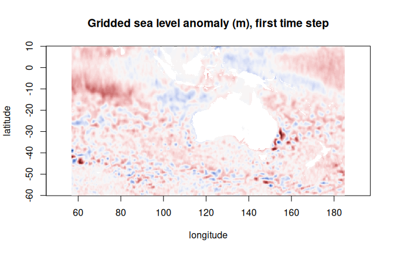

zaro reads Zarr arrays, native or virtual, from local disk, S3, GCS and
HTTP(S) into R. This article opens a public store, looks at what is in it
without reading any data, and reads a slice two ways: as an ordinary R
array, and as a lazy array that reads only what you index.

The store is AODN's gridded sea level anomaly for the Australasian region:
Zarr V2 on S3, about 4 GB per variable.


``` r
library(zaro)
options(zaro.verbose = FALSE)   # zaro explains what it does by default

store <- zaro("s3://aodn-cloud-optimised/model_sea_level_anomaly_gridded_realtime.zarr",
              anonymous = TRUE, region = "ap-southeast-2")
store
#> <ZaroStore> [zaro::ArrowStore]
#>   root: aodn-cloud-optimised/model_sea_level_anomaly_gridded_realtime.zarr
```

## What is in it

`zaro_dataset()` reads the store's consolidated metadata (one request) and
lists every array with its dimensions in R order. No array data is read.


``` r
ds <- zaro_dataset(store)
ds
#> <zaro_dataset> 8 array(s) [zaro::ArrowStore]
#>   GSL       float64  (LONGITUDE: 641, LATITUDE: 351, TIME: 2519)
#>   GSLA      float64  (LONGITUDE: 641, LATITUDE: 351, TIME: 2519)
#>   LATITUDE  float32  (LATITUDE: 351)
#>   LONGITUDE float32  (LONGITUDE: 641)
#>   TIME      float64  (TIME: 2519)
#>   UCUR      float64  (LONGITUDE: 641, LATITUDE: 351, TIME: 2519)
#>   VCUR      float64  (LONGITUDE: 641, LATITUDE: 351, TIME: 2519)
#>   filename  string   (TIME: 2519)
#>   attributes: 37
```

Each array's metadata is there too: data type, chunking, codecs and
attributes.


``` r
ds$arrays$GSLA
#> <ZaroMeta> [array]
#>   dtype:  float64
#>   shape:  [2519 x 351 x 641]
#>   chunks: [5 x 351 x 641]
#>   dims:   TIME, LATITUDE, LONGITUDE
#>   codecs: bytes -> blosc
#>   fill:   NaN
#>   size:   4.2 GB
#>   attrs:  5
ds$arrays$GSLA@attributes[c("long_name", "units")]
#> $long_name
#> [1] "gridded (adjusted) sea level anomaly "
#> 
#> $units
#> [1] "m"
```

## Read a slice

`zaro_read()` takes 0-based `start` and `count` in Zarr dimension order
(here `TIME, LATITUDE, LONGITUDE`); `NA` means the rest of that axis.


``` r
gsla <- zaro_read(store, "GSLA", start = c(0, 0, 0), count = c(1, NA, NA),
                  meta = ds$arrays$GSLA)
dim(gsla)
#>      TIME  LATITUDE LONGITUDE 
#>         1       351       641
lon <- zaro_read(store, "LONGITUDE", meta = ds$arrays$LONGITUDE)
lat <- zaro_read(store, "LATITUDE", meta = ds$arrays$LATITUDE)
```


``` r
z <- t(gsla[1, , ])
image(as.vector(lon), as.vector(lat), z, asp = 1, zlim = c(-1, 1) * max(abs(z), na.rm = TRUE),
      col = hcl.colors(64, "Blue-Red 3"), xlab = "longitude", ylab = "latitude",
      main = "Gridded sea level anomaly (m), first time step")
```



## Or index a lazy array

`zaro_array()` gives an ordinary-looking R array that reads chunks only
when you index it (it is an [altarr](https://hypertidy.github.io/altarr/)
ALTREP array). Dimensions are in R order, the reverse of Zarr's, so this
one is `LONGITUDE, LATITUDE, TIME`. With `cf = TRUE`, fill values read as
`NA` and any CF packing (`scale_factor`, `add_offset`) is applied.


``` r
x <- zaro_array(ds, "GSLA", cf = TRUE)
dim(x)
#> [1]  641  351 2519

## a 200-day time series at 155E, 35S (Tasman Sea): one planned read of
## the chunks it touches
i <- which.min(abs(lon - 155)); j <- which.min(abs(lat + 35))
c(lon[i], lat[j])
#> [1] 155 -35
ts <- x[cbind(i, j, 1:200)]
summary(ts)
#>    Min. 1st Qu.  Median    Mean 3rd Qu.    Max. 
#> -0.4010  0.1382  0.4242  0.3446  0.5358  0.8861
```

Nothing else is read: subsetting plans the chunks it needs, then fetches
them together. See the [planning and fetching](plan-fetch-shard.html)
article for what that plan looks like.
