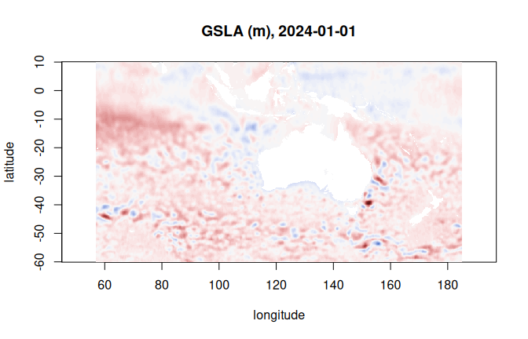

zaro gets the bytes; [ndr](https://hypertidy.github.io/ndr/) does the
meaning: named dimensions, coordinates, selection by value, broadcasting
and reductions. `ndr::open_dataset()` reads through zaro for Zarr and
virtual Zarr (and through GDAL for NetCDF, HDF5 and friends). The zaro
engine is chosen for `s3://`, `gs://`, `virtualizarr://`, `byterefs://`
and `.zarr` sources, or with `engine = "zaro"`.


``` r
library(ndr)
options(zaro.verbose = FALSE)

ds <- open_dataset("s3://aodn-cloud-optimised/model_sea_level_anomaly_gridded_realtime.zarr",
                   vars = "GSLA", anonymous = TRUE, region = "ap-southeast-2")
ds
#> <Dataset>
#>   Dimensions:  (LONGITUDE: 641, LATITUDE: 351, TIME: 2519)
#>   Coordinates:
#>     * LATITUDE  (LATITUDE) numeric -60 ... 10
#>     * LONGITUDE  (LONGITUDE) numeric 57 ... 185
#>     * TIME  (TIME) Date 2020-01-23 ... 2026-11-05
#>   Data variables:
#>     GSLA                 (LONGITUDE, LATITUDE, TIME) [not loaded] ~4.2 GB
#>   Attributes:
#>     Conventions: CF-1.6,IMOS-1.4
#>     abstract: Gridded (adjusted) sea level anomaly (GSLA), gridded sea level (GSL) and surface geostrophic velocity (UCUR,VCUR) for the Australasian region. GSLA is mapped using optimal interpolation of detided, de-meaned, inverse-barometer-adjusted altimeter and tidegauge estimates of sea level. GSL is GSLA plus an estimate of the departure of mean sea level from the geoid. The geostrophic velocities are derived from GSL.
#>     acknowledgement: Any users of IMOS data are required to clearly acknowledge the source of the material derived from IMOS in the format: "Data was sourced from the Integrated Marine Observing System (IMOS) - IMOS is a national collaborative research infrastructure, supported by the Australian Government." If relevant, also credit other organisations involved in collection of this particular datastream (as listed in "credit" in the metadata record).
#>     author: Pilo, Gabriela S
#>     author_email: gabriela.semolinipilo@csiro.au
#>     citation: The citation in a list of references is: "IMOS [year-of-data-download], [Title], [data-access-URL], accessed [date-of-access]."
#>     data_centre: Australian Ocean Data Network (AODN)
#>     data_centre_email: info@aodn.org.au
#>     dataset_name: model_sea_level_anomaly_gridded_realtime
#>     date_created: 2026-11-07T22:38:28Z
#>     disclaimer: Data, products and services from IMOS are provided "as is" without any warranty as to fitness for a particular purpose.
#>     distribution_statement: Data may be re-used, provided that related metadata explaining the data has been reviewed by the user, and the data is appropriately acknowledged.
#>     geospatial_lat_max: 10
#>     geospatial_lat_min: -60
#>     geospatial_lat_units: degrees_north
#>     geospatial_lon_max: 185
#>     geospatial_lon_min: 57
#>     geospatial_lon_units: degrees_east
#>     geospatial_vertical_max: 0
#>     geospatial_vertical_min: 0
#>     geospatial_vertical_units: m
#>     history:  
#>     institution: CSIRO Marine and Atmospheric Research
#>     license: http://creativecommons.org/licenses/by/4.0/
#>     metadata_uuid: 0c9eb39c-9cbe-4c6a-8a10-5867087e703a
#>     naming_authority: IMOS
#>     netcdf_version: 4.0
#>     platform_code: GSLA
#>     principal_investigator: Griffin, David
#>     principal_investigator_email: david.griffin@csiro.au
#>     product_type: NRT00
#>     project: Integrated Marine Observing System (IMOS)
#>     references: http://imos.aodn.org.au/oceancurrent
#>     standard_name_vocabulary: NetCDF Climate and Forecast (CF) Metadata Convention Standard Name Table 60
#>     time_coverage_end: 2026-11-06T00:00:00Z
#>     time_coverage_start: 2026-10-11T07:47:54Z
#>     title: Ocean Current
```

Opening read only metadata and coordinates; `TIME` is already decoded to
dates. Data variables are lazy: selecting stays lazy, and values are read
(by zaro, chunk by chunk) only when needed.


``` r
gsla <- ds$GSLA
day <- gsla |> sel(TIME = as.Date("2024-01-01"))
day@variable@dims             # TIME selected away; still lazy
#> [1] "LONGITUDE" "LATITUDE"
ndr:::is_lazy(day@variable@data)
#> [1] TRUE
```


``` r
v <- collect(day)
lon <- coord_values(ds@coords$LONGITUDE); lat <- coord_values(ds@coords$LATITUDE)
z <- v@variable@data
image(lon, lat, z, asp = 1, zlim = c(-1, 1) * max(abs(z), na.rm = TRUE),
      col = hcl.colors(64, "Blue-Red 3"),
      xlab = "longitude", ylab = "latitude", main = "GSLA (m), 2024-01-01")
```



A reduction streams the chunks it needs:


``` r
jan <- gsla |> sel(TIME = c(as.Date("2024-01-01"), as.Date("2024-01-31")))
m <- nd_mean(jan, "TIME", na.rm = TRUE)
range(collect(m)@variable@data, na.rm = TRUE)
#> [1] -0.5218396  0.8124282
```

The same code reads virtual stores: a VirtualiZarr or byterefs reference
store opens with `open_dataset("virtualizarr://...")` or
`open_dataset("byterefs://...")`, and its packed variables are unpacked as
they are read.
